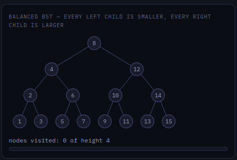
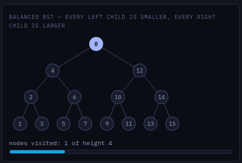
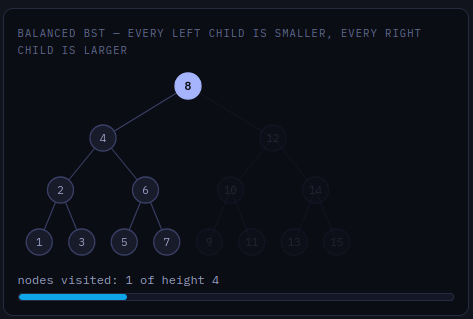
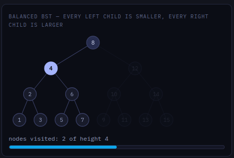
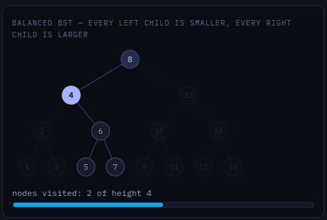
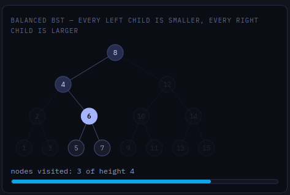
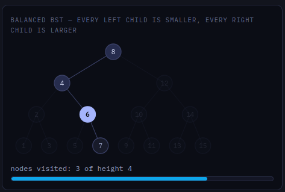
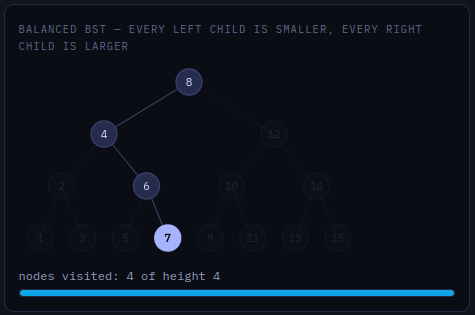

# **Time complexity and space complexity.**

### *What is time complexity?*

**Time complexity** tells you how the number of steps in your algorithm grows with input size.

It doesn't measure actual seconds — it shows how the work grows as your input grows. For example, doubling the input might double the work (O(n)), or quadruple it (O(n²)). Push the input 10× larger and that O(n²) cost balloons 100×. It's a way to predict how your code will scale — before you ever run it and time it.

### *What is space complexity?*

**Space complexity** is how much memory your algorithm needs to run — not just for the input, but for any extra variables, data structures, or recursive calls. Think of it as:

    > Space complexity = input space + extra (auxiliary) space

Efficient code often balances time and space. Using more memory might speed things up — or vice versa. Big O helps you think through those trade-offs.

---
### **O(1) — constant time**

Accessing an element by index

No matter how large the input, the algorithm will always take the same amount of time to complete.

        input: my_list = [7, 12, 3, 9, 5, 14, 8, 2] (n = 8)

        def get_first(my_list):
            return my_list[0]

---
### **O(1) — key insight**

***Fixed constants are still O(1)***

Even when you iterate over a fixed, unchanging collection like the English alphabet, it's still considered O(1) constant time.

This function is O(26) — but since 26 is a constant that never changes regardless of input size, we simplify it to O(1). Whether your program processes 1 user or 1 million users, this function will always take exactly the same 26 steps.

    input: none — the function takes no input at all; the alphabet is hard-coded inside it

        def count_vowels_in_alphabet():
            alphabet = "abcdefghijklmnopqrstuvwxyz"
            vowels = "aeiou"
            count = 0
            for letter in alphabet:  # always exactly 26 iterations
                if letter in vowels:
                    count += 1
            return count

---

### **O(1) — even with input**

Touching a fixed number of elements

The same holds even when a function does take input — as long as it only ever touches a fixed number of elements.

Here numbers can hold 10 or 10 million values, but we only ever read the first 3. Try changing n to one million below — the operation counter still stops at 3.

        input: numbers = [7, 12, 3, 9, 5, 14, 8, 2, 11, 6] (n = 10)

        def sum_first_three(numbers):
            # 'numbers' can hold 10 or 10 million values,
            # but we only ever read the first 3
            return numbers[0] + numbers[1] + numbers[2]

---

### **O(n) — linear time**

Iterating through an array

Linear time is achieved when the running time of an algorithm increases linearly with the length of the input. When a function runs for or iterates over an input size of n, it is said to have a time complexity of order O(n).

The function below takes O(n) time (or "linear time") to complete, where n is the number of entries in the array: it will print 10 times if the array has 10 entries, and 100 times if it has 100. Verify it with the n selector.

        input: my_list = [7, 12, 3, 9, 5, 14, 8, 2, 11, 6] (n = 10)

        def print_all_elements(my_list):
            for element in my_list:
                print(element)

---
### **O(n) — common question**

What if you only loop through half the list?

Even if you loop through just part of the input — say, the first n/2 elements — it's still considered O(n).

Why? Because Big O ignores constant factors. In Big O notation, n/2 simplifies to n — and 3n, 5n, or 0.1n also simplify to n.

Big O focuses on growth rate, not exact steps. Run the simulator at n = 6 and again at n = 20: the operation count is always half of n, so the time still grows linearly as the input gets bigger.

        input: my_list = [7, 12, 3, 9, 5, 14, 8, 2, 11, 6] (n = 10)

        def print_first_half(my_list):
            half = len(my_list) // 2
            for i in range(half):
                print(my_list[i])

---
### **O(log n) — logarithmic time**

*Halve the problem every step*

When the size of the input data decreases in each step by a certain factor, an algorithm has logarithmic time complexity: as input grows, the number of operations grows comparatively much slower.

Think of finding a word in a dictionary. You could go through every letter — that's linear O(n). Or you could open the book to the exact center page: if your word comes before it, search the left half; otherwise, the right half. You're reducing your input size by half every time, so the operations needed shrink dramatically — that's O(log n).

Binary Search takes a sorted list and does exactly this. With every iteration the search list shrinks by half — watch the discarded half fade out at each cut. Type any number into the "search for x" box to change the target, and use the n dropdown to grow the list: at n = 1000 a search still takes at most ⌈log₂ 1000⌉ = 10 comparisons (1000 → 500 → 250 → 125 → … → 1).

    input: lst = [2, 5, 8, 12, 16, 23, 38, 45, 56, 61, 72, 84, 91, 99] (n = 14, sorted) 
    
    x = 2

        def binarySearch(lst, x):
            low = 0
            high = len(lst)-1
            while low <= high:
                mid = low + (high-low)//2
                if lst[mid] == x:
                    return mid
                elif lst[mid] < x:
                    low = mid + 1
                else:
                    high = mid - 1
            return -1

---

### *O(log n) — in trees*

**Why is searching a balanced BST O(log n)?**

In a binary search tree, every node's left subtree holds smaller values and its right subtree holds larger values. That ordering means every comparison lets you discard an entire subtree: if x is smaller than the current node, nothing in the right subtree can possibly contain it — so you never look there. It's binary search in tree form. Each comparison moves you down exactly one level, so the total comparisons can never exceed the tree's height.

The default target below is x = 7 — a leaf at the center of the bottom level, so the search walks a full root-to-leaf path. Watch half the remaining tree fade away at every comparison. Type another number into "find x" (try one that isn't in the tree, like 20 — even a failed search stays within the height).

    input: a balanced BST of 15 nodes (values 1–15, root = 8, height = 4 ≈ log₂ 15) · x = 7

    def search(node, x):
        while node:
            if x == node.val:
                return node        # found!
            elif x < node.val:
                node = node.left   # discard the RIGHT subtree
            else:
                node = node.right  # discard the LEFT subtree
        return None                # not in the tree

*    (balanced BST — every left child is smaller, every right child is larger)

---

***Why is a balanced tree's height about log n?***

A balanced binary tree fills each level before moving to the next, and every level holds twice as many nodes as the one above: level 0 has 1 node, level 1 has 2, level 2 has 4, level 3 has 8 — level k holds 2ᵏ nodes. A tree of height h therefore holds roughly 1 + 2 + 4 + … + 2ʰ ≈ 2ʰ⁺¹ nodes. Turning that around: with n nodes, n ≈ 2ʰ, so h ≈ log₂(n). Each time you double the nodes you add only one level — that inverse-of-doubling relationship is exactly what a logarithm is.
Best, average, and worst case in an interview

- ***Best case — O(log n)***: a perfectly balanced tree, where every level is full and the height is exactly log n.

- ***Average case — O(log n)***: a tree built from randomly ordered inserts still tends to stay roughly balanced, so the expected height stays on the order of log n.

- ***Worst case — O(n)***: the skewed tree. Insert already-sorted data (7, 6, 5, 4, …) and every node becomes a child on the same side — the tree degenerates into a linked list of height n. Switch the simulator above to "skewed" and search for 1: no comparison discards anything (the right subtrees are all empty), so the same code visits ALL n nodes.

Expert interviewers deliberately bring up the skewed case, because answering "a BST is O(log n)" is only half the truth — that bound holds for the average and balanced cases, not the worst. 

 
- search called: start at the root (node = 8), looking for x = 7
- node is not None (node = 8) — keep going
- comparison 1: is 7 == 8?
- 7 < 8 → x must be in the LEFT subtree. The entire RIGHT subtree of 8 (7 nodes) fades away — discarded in ONE comparison

- node = node.left → move down to 4

- node is not None (node = 4) — keep going
- comparison 2: is 7 == 4?
- 7 > 4 → x must be in the RIGHT subtree. The entire LEFT subtree of 4 (3 nodes) fades away — discarded in ONE comparison

- node = node.right → move down to 6

- node is not None (node = 6) — keep going
- comparison 3: is 7 == 6?
- 7 > 6 → x must be in the RIGHT subtree. The entire LEFT subtree of 6 (1 node) fades away — discarded in ONE comparison 

node = node.right → move down to 7

- node is not None (node = 7) — keep going
- comparison 4: is 7 == 7?
- Yes — found 7!